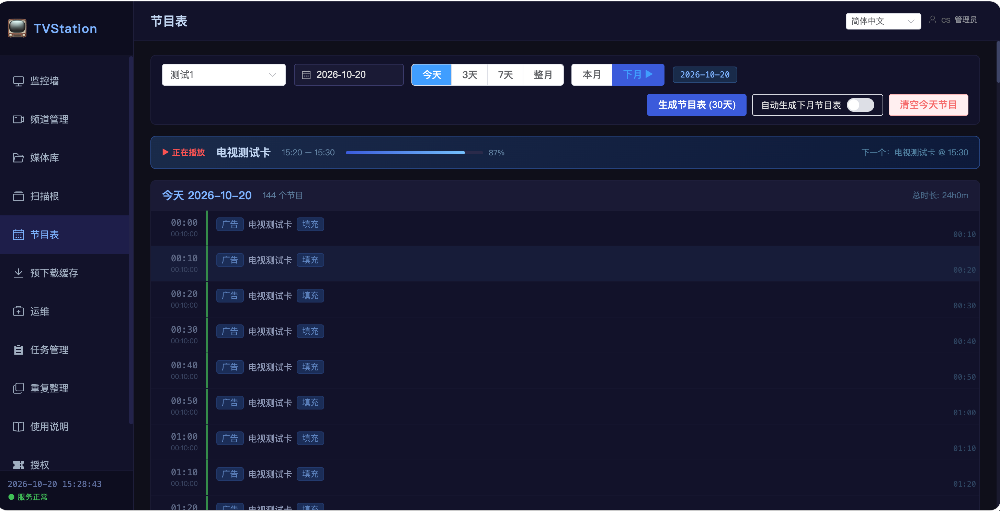
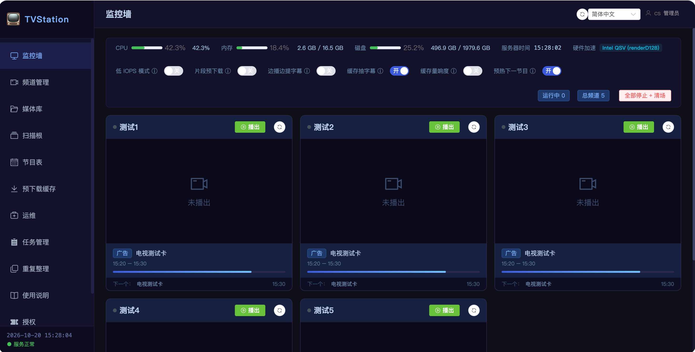
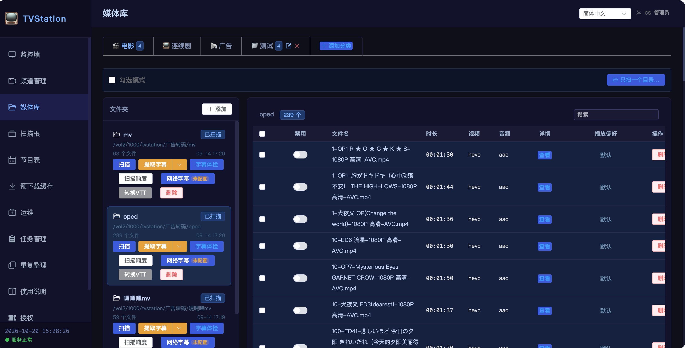
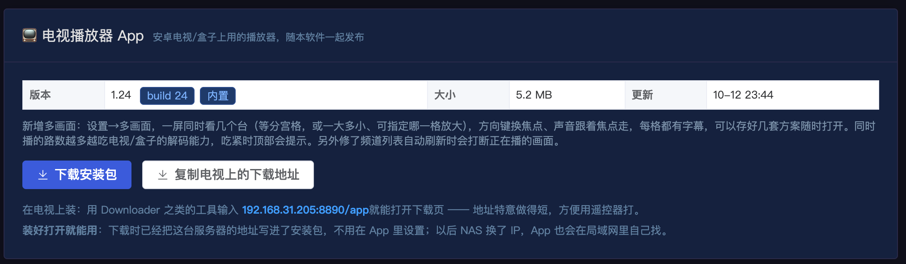

# TVStation

**把片库排成会自己播下去的电视频道**

开机就有节目，不用挑、不用点播 —— 像电视台那样，打开就可以看。

---

## 为什么会有这个项目

玩影音库很长时间了，但是发现每次都是重在折腾：分类、刮削、整理，
然后看了一段时间，反而可能就不想看了。

于是想着：能不能把影音库里那些喜欢的内容，**像电视台那样播放出来** ——
打开就可以看，完全仿照电视台的播放模式。

TVStation 就是这么一个软件。它把你 NAS 里的电影和剧集排成真正的电视频道：
连续剧从第一集按顺序往下播、跨天接着播，电影按时段轮换，中间插广告或片头。
电视一开就有画面，遥控器换台就行 —— 只不过播的全部是你自己的片库。

**它不是播放器，是电视台。** 没有播放列表，没有"继续观看"，没有海报墙要你选。只有频道。

---

## 门槛很低 —— 尤其是硬盘涨价的当下

- **可以直接使用网盘**：片库放在网盘挂载目录里也能播，配合「预下载缓存」提前把节目拉到本地，
  不必把一切都落到硬盘上。
- **一块 2T 甚至更低的机械硬盘就够**：现在很多人手里都有淘汰下来的旧硬盘，正好可以利用上，
  自建近 50 个频道没有问题。
- **低配主机就够用**：默认「直接流」模式不重新编码，几乎不吃 CPU。
  参考配置：i3 8100 + 16G 内存 + 两块 2T + 一块 1T 硬盘，实际创建了 70 多个频道。
- **自动选国语字幕和国语音轨**：只要你的电影文件里有，就自动优先国语字幕、国语音频。
- **软件基本上免费**：付费功能主要是频道创建。新安装起半个月内可无限创建频道，
  到期后限制为 3 个频道 —— 家里开「综合」「电影」「少儿」三个频道通常够用。
- **软件内置使用说明**，操作非常简单，但是功能非常强大。

---

## 界面

<b>节目表</b> —— 你片库的 EPG：提前排一个月，可视、可改、可清

<b>监控墙</b> —— 所有频道实时画面一览，CPU / 内存 / 磁盘 / 硬件加速状态尽收眼底

<b>媒体库</b> —— 电影 / 连续剧 / 广告分区管理，扫描、字幕匹配、转码一站式

<b>电视播放器 App</b> —— 安卓电视 / 盒子上使用，最多 8 个频道同屏观看

---

## 它能做什么

**排片**
- 连续剧按集追踪，播完一集接下一集，跨天不断线；一部播完自动换下一部
- 时间不够放整集时用广告填到下一个整点，不会把剧腰斩
- 电影按时段随机轮换；支持"今天第一部、明天第二部"的系列片顺序
- 三种排片模式：按时段编排 / 按目录顺序 / 连续播放
- 提前排一个月，节目表可视、可改、可清；可开启「自动生成下月节目表」

**播出**
- 三种模式：转码播放 / 智能模式 / 直接流（默认直接流，NAS 上几乎不吃 CPU）
- Intel 核显硬件转码（QSV）
- 外挂与内嵌文字字幕、HDR 转 SDR、响度归一化
- 节目表用完不黑屏：自动播内置的电视测试卡
- 播出切片放在内存盘（tmpfs）上，不写硬盘

**片源**
- 本地目录 + 网盘挂载目录 + 预下载缓存
- 按 nfo 刮削信息识别剧名集数，没刮削过的也能认
- 重复文件整理、断链修复、字幕自动匹配

**看**
- 标准 M3U + XMLTV EPG，电视、Kodi、VLC、Infuse 都认
- 自带安卓电视播放器（APK 可直接从 NAS 下载安装），多画面模式一屏同看最多 8 个频道
- 网页监控墙，所有频道实时画面一览

---

## 下载

发布包挂在本仓库的 **Releases** 里（网页右侧「Releases」栏目进入）：

**[→ 前往 Releases 下载页](https://github.com/hahawsss/TVStation/releases)**

| 发布包 | 用途 |
|---|---|
| `TVStation-2.2.48.fpk` | 飞牛 fnOS 原生版：应用中心手动安装，不用 Docker、不用任何配置 |
| `tvstation-2.2.48-compiled-amd64.tar.gz` | Docker 镜像包：群晖 / 威联通 / Unraid / Portainer / 命令行 |

下载后按下面的「安装」一节操作即可。

---

## 安装

| 你用的是 | 怎么装 |
|---|---|
| **飞牛 fnOS** | 最省事：应用中心 → 手动安装 → 选发布包里的 `.fpk`。不用 Docker、不用任何配置。 |
| 飞牛 / 群晖 / 威联通 / Unraid / Portainer / 命令行（Docker） | 按 [`tvstation-2.2.48-docker/安装说明.md`](tvstation-2.2.48-docker/安装说明.md) 照做，`docker-compose.yml` 已经写好。 |

装好后浏览器打开 `http://NAS地址:8890`，第一次进去设置管理员账号，
再按界面里的「**使用说明**」走五步：加媒体库 → 建频道 → 配时段 → 生成节目表 → 开播。

> Docker 版要注意一件事：播出切片必须放在**内存盘**上（compose 里已经写好）。
> 很多 NAS 的「容器」界面不认这一项，在那里编辑容器会把它弄丢 ——
> 丢了的话软件每个页面顶部会红色提示，点「打开修复向导」按平台照做即可。

---

## 免费版 / 个人版

**免费版不是试用，是可以一直用下去的完整软件。** 播出、转码、字幕、M3U/EPG、
监控墙、网盘片源、预下载缓存都能用 —— 差别在**规模**和**省心**。

| | 免费版 | 个人版 |
|---|:---:|:---:|
| 频道数 | 3 | 不限 |
| 播出 / 转码 / 字幕 / M3U + EPG / 监控墙 | ✓ | ✓ |
| 网盘片源 + 预下载缓存 | ✓ | ✓ |
| 节目表自动续期 | — | ✓ |
| 并发上限可调 | — | ✓ |
| 响度归一化 | — | ✓ |
| 字幕防错配、字幕 / 音轨语言优先级 | — | ✓ |
| 重复整理、自动备份 | — | ✓ |
| 自定义媒体分类 | — | ✓ |
| 多块缓存盘、多个扫描根、定期扫描 | — | ✓ |
| 媒体源挂载切换、媒体路径迁移 | — | ✓ |

> 新安装起半个月内可无限创建频道；到期后按免费版限制为 3 个频道。
> 免费版的节目表不会自动续期，但频道**不会黑屏** —— 下个月会自动填成内置的电视测试卡，
> 你随时可以手动排出真节目。

**到期不停播。** 个人版授权到期后自动降为免费版继续播出 ——
频道配置和节目表**一条都不会丢**，续费装上新证书立即恢复。

---

## 购买

**个人版：60 元 / 年。**

1. 打开软件的「**授权**」页，填接收证书的邮箱，点「**生成申请码**」
2. 点「**打开购买页**」—— 申请码会自动带过去
3. 核对邮箱，下单，用**支付宝**付款
4. 付款后一两分钟，证书会显示在订单页上，同时发到你的邮箱
5. 把证书粘回「授权」页，点「**装上证书**」

证书**绑定你这台设备**。续费照同样的步骤走，会从原到期日往后顺延，提前续费不吃亏。

---

## 常见问题

**Q：免费版够用吗？**
家里三个频道（比如"综合""电影""少儿"）通常够。频道多了、或者想要节目表自动续期这类省心功能，再考虑个人版。

**Q：会不会占很多 CPU？**
默认是「直接流」，不重新编码，一路只占几个百分点。只有片源编码电视不支持时才转码。

**Q：有些片子从来不播？**
「直接流」模式下，mpegts 不支持的编码（RV40/VP9/AV1/WMV 等）会被排除。在频道的
「强制转码编码」里勾上它，或改成「智能模式」。

**Q：数据会被锁住吗？**
不会。授权到期只影响频道数和付费功能，你的片库、频道编排、节目表都在本地数据库里，
随时可以备份导出。

**Q：需要联网吗？**
软件运行不需要联网。购买时在任意一台能上网的设备上打开购买页就行，证书是一段文本，粘贴进软件即可。

---

## 授权与法律

**使用范围**：本软件**仅限个人非商业用途**，不得用于营业场所对外播放。详见软件内的使用条款。

**软件授权**：本软件以二进制形式分发，未开源。购买的授权仅供**你自己使用**，
不可转售、不可分发。

**内容责任**：本软件只提供播出工具，**不提供、不索引、不推荐任何影视内容**。
你播出的所有片源由你自己提供，相关责任由使用者承担。

**开源组件**：本软件包含以下自由软件组件，它们各自的许可证独立于本软件：

| 组件 | 许可证 | 对应源码 |
|---|---|---|
| FFmpeg | GPL-3.0 | https://sources.debian.org/src/ffmpeg/ |
| MKVToolNix | GPL-2.0 | https://sources.debian.org/src/mkvtoolnix/ |
| 文泉驿微米黑 | GPL-2.0 with font exception | https://sources.debian.org/src/wqy-microhei/ |
| Python 及其标准库 | PSF License | https://www.python.org/downloads/ |

上述组件均**未经修改**地取自 Debian 官方软件包。如需对应版本的完整源码，
可从上表链接获取，或来信索取。

---

## 反馈

- 邮件：asdf269611012@163.com（标题请以「TVStation 问题反馈」开头）
- 购买页：https://tvmssq.online/

 
TVStation · 开机就有节目

